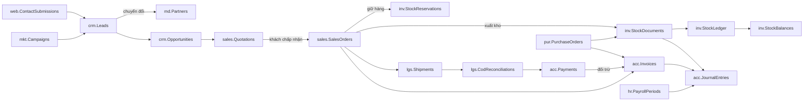
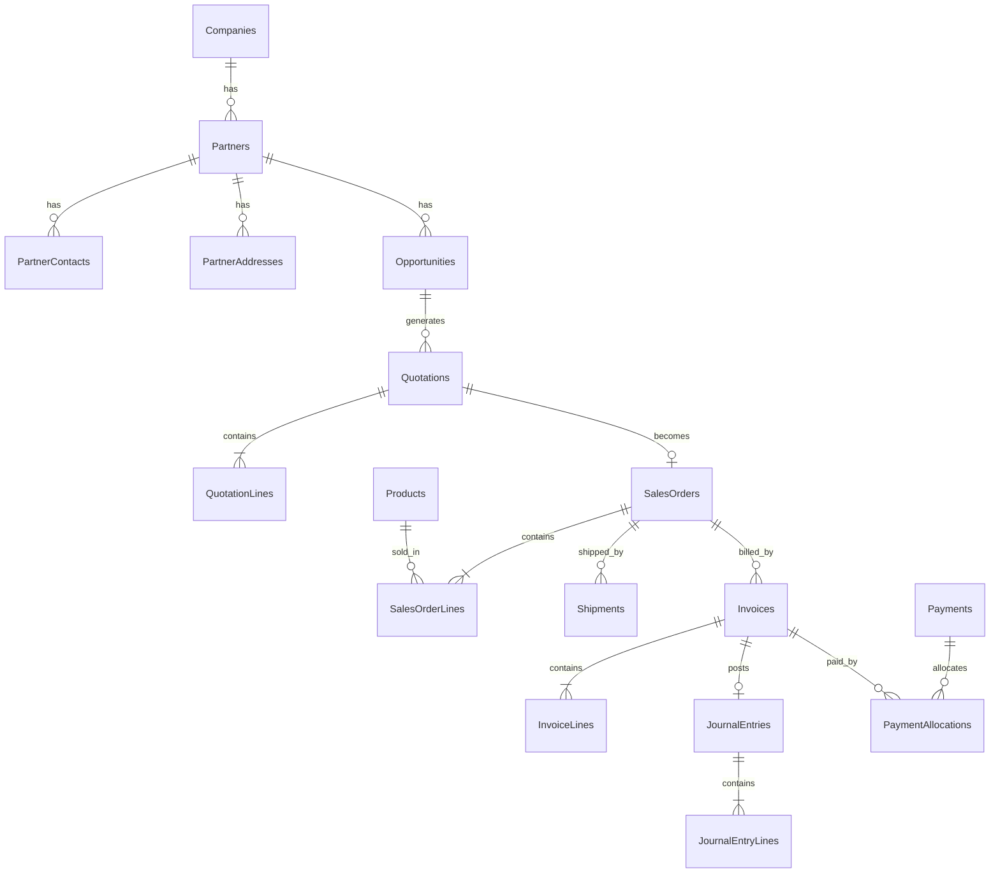

# MyERP – Thiết kế cơ sở dữ liệu

Database: **SQL Server** (đã chạy thử trên SQL Server 2025), tên `MyERP`.
Quy mô: **157 bảng · 15 schema · 457 khóa ngoại · 158 ràng buộc CHECK · 286 index**.

## Cách chạy

```powershell
cd C:\.Net\CRM\database
.\run_all.ps1              # tạo mới (Windows Authentication, localhost)
.\run_all.ps1 -Recreate    # xóa MyERP và tạo lại từ đầu
.\run_all.ps1 -NoSeed      # chỉ tạo cấu trúc, không nạp dữ liệu khởi tạo
```

## Các file

| File | Schema | Nội dung |
|---|---|---|
| `00_create_database.sql` | | Tạo DB, collation, bật READ_COMMITTED_SNAPSHOT |
| `01_core.sql` | `core` | Công ty, chi nhánh, phòng ban, user, phân quyền, ứng dụng, đánh số chứng từ, audit, file, bình luận, thông báo, tag, trường tùy biến, quy trình duyệt, outbox |
| `02_master_data.sql` | `md` | Tiền tệ, tỷ giá, tỉnh/phường, đơn vị tính, thuế, điều khoản thanh toán, **đối tác** (khách hàng + NCC + hãng vận chuyển), sản phẩm, bảng giá |
| `03_hr.sql` | `hr` | Nhân viên, hợp đồng, chấm công, nghỉ phép, tính lương, tuyển dụng |
| `04_inventory.sql` | `inv` | Kho, vị trí, lô/serial, phiếu kho, sổ kho, tồn kho, kiểm kê |
| `05_crm.sql` | `crm` | Lead, đội sale, pipeline, cơ hội, lịch sử giai đoạn, hoạt động |
| `06_sales.sql` | `sales` | Báo giá, đơn bán, giữ hàng, trả hàng, khuyến mãi |
| `07_purchasing.sql` | `pur` | Yêu cầu mua, đơn mua |
| `08_logistics.sql` | `lgs` | Hãng vận chuyển, xe, vận đơn, hành trình, đối soát COD |
| `09_marketing.sql` | `mkt` | Chiến dịch, phân khúc, mẫu tin, gửi tin hàng loạt, đồng ý nhận tin |
| `10_accounting.sql` | `acc` | Năm/kỳ kế toán, hệ thống TK, bút toán, hóa đơn (kèm HĐĐT), thu chi, đối trừ công nợ, sao kê, TSCĐ |
| `11_support.sql` | `cs` | Ticket, SLA, bảo hành |
| `12_project.sql` | `prj` | Dự án, công việc, Kanban, timesheet |
| `13_website.sql` | `web` | Site, trang, bài viết, menu, tài khoản khách, giỏ hàng, form liên hệ |
| `14_document_chat.sql` | `doc`, `chat` | Thư mục, tài liệu, phiên bản, chia sẻ, ký số; chat nội bộ |
| `20_views.sql` | | Tồn khả dụng, cân đối phát sinh, tuổi nợ, pipeline, doanh số tháng |
| `30_seed.sql` | | Dữ liệu khởi tạo (xem cuối file này) |

## Quy ước thiết kế

| Hạng mục | Quy ước | Lý do |
|---|---|---|
| Khóa chính | `Id BIGINT IDENTITY` | Nhỏ, nhanh, index tốt hơn GUID; GUID chỉ dùng cho `OutboxMessages` |
| Đa công ty | Bảng nghiệp vụ có `CompanyId` | Một hệ thống chạy được nhiều công ty / bán dạng SaaS |
| Mã chứng từ | `DocNo`/`Code` duy nhất theo `(CompanyId, Code)` | Mã không tái sử dụng kể cả khi xóa mềm, đúng yêu cầu kế toán |
| Đánh số | `core.Sequences` + `core.usp_NextDocNo` (khóa `UPDLOCK`) | Không trùng số khi nhiều người tạo cùng lúc. VD `DH2611-00001` |
| Audit | `CreatedAt/By`, `UpdatedAt/By`, `core.AuditLogs` lưu JSON cũ/mới | Truy vết ai sửa gì. `CreatedBy` không đặt FK để tránh hàng trăm FK tới Users |
| Xóa mềm | `IsDeleted` trên bảng chính, dòng chi tiết xóa theo header | Không mất dữ liệu; dùng filtered index `WHERE IsDeleted = 0` |
| Đồng thời | `RowVersion ROWVERSION` | Optimistic concurrency với EF Core: hai người cùng sửa một đơn sẽ báo xung đột |
| Thời gian | `DATETIME2(3)` lưu **UTC**; ngày nghiệp vụ dùng `DATE` | Tránh lệch múi giờ |
| Tiền | `DECIMAL(18,2)`; đơn giá, số lượng `DECIMAL(18,4)`; tỷ giá `DECIMAL(18,6)` | Không dùng FLOAT cho tiền |
| Trạng thái | `VARCHAR` + `CHECK` (VD `'draft','confirmed'`) | Đọc được trực tiếp trong DB, map sang enum C# |
| Chuỗi | `NVARCHAR` cho tiếng Việt, `VARCHAR` cho mã/email/SĐT | Tiết kiệm dung lượng |
| Collation | `Latin1_General_100_CI_AI` | Gõ "nguyen van an" ra "Nguyễn Văn An", "do duc" ra "Đỗ Đức" |
| Cascade | Chỉ `header → dòng chi tiết` | Tránh xóa dây chuyền ngoài ý muốn |
| Liên kết đa hình | `EntityName + EntityId` (Activities, Attachments, Comments, Tags) | Một bảng dùng chung cho mọi loại chứng từ |
| Snapshot giá trị | Dòng chứng từ lưu `TaxRate`, `UnitPrice`, `UnitCost` tại thời điểm lập | Đổi giá hay thuế sau này không làm sai chứng từ cũ |

## Luồng liên thông giữa các phòng ban



Các module giao tiếp qua **sự kiện** ghi vào `core.OutboxMessages` trong cùng transaction (Transactional Outbox). Một background job đọc sự kiện và gọi module khác. Ví dụ `Sales.OrderConfirmed` dẫn tới Kho giữ hàng; `Inventory.GoodsIssued` dẫn tới Kế toán ghi giá vốn. Không module nào ghi thẳng vào bảng của module khác.

## Sơ đồ quan hệ phần lõi bán hàng



## Quy tắc nghiệp vụ được ép ngay trong DB (đã kiểm thử)

| Quy tắc | Cơ chế | Kết quả thử |
|---|---|---|
| Bút toán ghi sổ phải cân Nợ = Có | `CK_JournalEntries_Balanced` | Chặn đúng |
| Một dòng bút toán không vừa Nợ vừa Có | `CK_JournalEntryLines_Amounts` | Chặn đúng |
| Không sửa/xóa bút toán đã ghi sổ (phải tạo bút toán đảo) | Trigger `trg_JournalEntryLines_Locked` | Chặn đúng |
| Không ghi sổ vào kỳ đã khóa; ngày hạch toán phải thuộc kỳ | Trigger `trg_JournalEntries_ClosedPeriod` | Chặn đúng |
| Số chứng từ không trùng, tự reset theo tháng | `core.usp_NextDocNo` | `DH2611-00001`, `DH2611-00002`, sang tháng 12 ra `DH2612-00001` |
| Số đã thu không vượt tổng hóa đơn | `CK_Invoices_Amounts` | |
| Hàng trả không vượt hàng đã giao | `CK_SalesOrderLines_Progress` | |
| Một vận đơn chỉ đối soát COD một lần | `UQ_CodReconLines_Shipment` | |
| Không trùng số hóa đơn của cùng nhà cung cấp | `UX_Invoices_SupplierNo` | |

Các quy tắc phức tạp hơn (hạn mức công nợ, cảnh báo xuất kho âm, tính giá vốn bình quân, công thức lương) nằm ở **tầng Application (.NET)**, vì chúng cần cấu hình và thông báo lỗi thân thiện.

## Dữ liệu khởi tạo (`30_seed.sql`)

- 17 ứng dụng (khớp màn hình lưới), 110 quyền, 11 vai trò mẫu đã gán quyền và phạm vi dữ liệu
- Công ty demo `ABC`, 9 phòng ban, kho tổng, tài khoản `admin` **chưa có mật khẩu**: ứng dụng phải bắt đặt mật khẩu ở lần chạy đầu
- 30 dãy số chứng từ
- 79 tài khoản kế toán TT200 thông dụng, tài khoản mặc định cho hạch toán tự động, 9 sổ nhật ký, thuế GTGT 0/5/8/10%
- Pipeline 7 giai đoạn, nguồn lead, lý do thất bại, ca làm việc, loại nghỉ phép, SLA, năm tài chính 2026 với 12 kỳ, quy tắc duyệt báo giá trên 100 triệu và 500 triệu

**Chưa seed:** danh mục 34 tỉnh/thành và phường/xã (mô hình 2 cấp từ 01/07/2025). Cần import từ danh mục chính thức của Tổng cục Thống kê.

## Lưu ý khi đưa vào code .NET

1. Bộ script này là **bản thiết kế chuẩn (baseline)**. Khi bắt đầu code, chọn một trong hai cách:
   - **Database-first:** `dotnet ef dbcontext scaffold` theo từng schema để sinh entity cho từng module.
   - **Code-first (khuyến nghị lâu dài):** viết entity theo đúng thiết kế này, mỗi module một `DbContext` với `HasDefaultSchema("sales")`..., rồi quản lý thay đổi bằng EF Core Migrations.
2. Dữ liệu nhạy cảm (`hr.Employees.IdNumber`, `BankAccountNo`, `lgs.Carriers.ApiConfig`) nên mã hóa ở tầng ứng dụng hoặc dùng Always Encrypted.
3. Các bảng sẽ lớn nhanh (`AuditLogs`, `StockLedger`, `JournalEntryLines`, `chat.Messages`, `ShipmentTrackingEvents`) nên có kế hoạch partition theo tháng hoặc lưu trữ dữ liệu cũ khi vượt vài chục triệu dòng.
4. Chưa có: sản xuất (BOM nhiều cấp, lệnh sản xuất), biến thể sản phẩm (size/màu), POS bán lẻ, đa ngôn ngữ nội dung. Bổ sung khi có nhu cầu.
